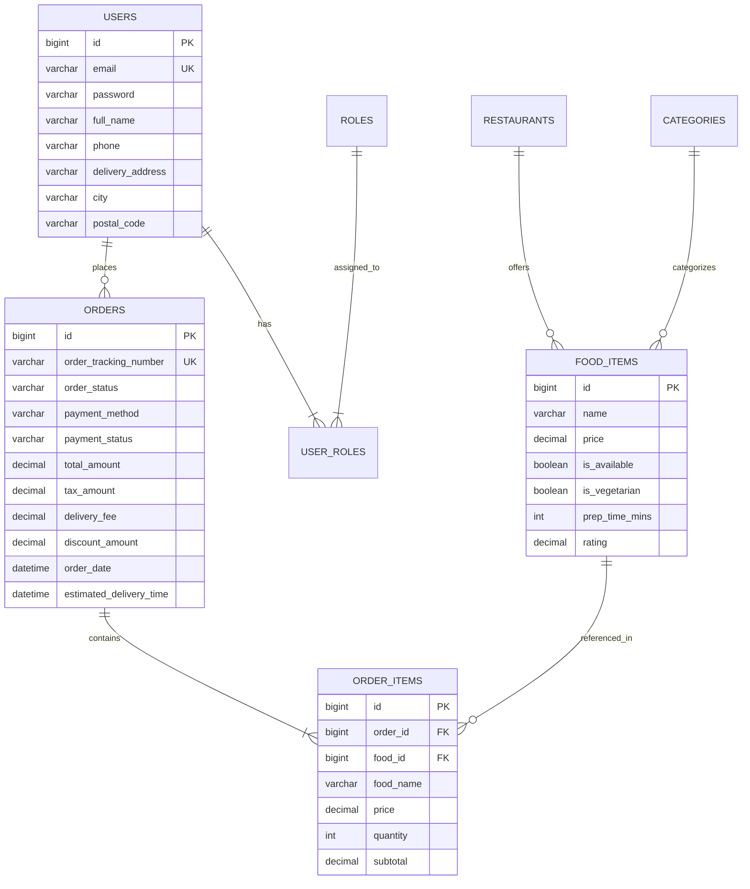

# 🍔 FoodExpress – Online Food Ordering & Restaurant Management System

[](https://openjdk.org/)
[](https://spring.io/projects/spring-boot)
[](https://spring.io/projects/spring-security)
[](https://www.mysql.com/)
[](https://www.thymeleaf.org/)
[](https://github.com/nithin20kb-glitch/Online_food_order)
[](LICENSE)

> **FoodExpress** is a full-stack, enterprise-grade online food ordering and restaurant management web application engineered with **Java 21 LTS**, **Spring Boot 3.3.5**, **Thymeleaf**, **Spring Data JPA / Hibernate**, and **MySQL 8.x** (with embedded H2 zero-setup fallback).
> Built as an IEEE-standard Software Engineering capstone project adhering to MVC design patterns, Agile sprint methodology, and automated CI/CD pipelines.

---

## 📑 Table of Contents
- [Project Architecture](#-project-architecture)
- [Key Modules & Features](#-key-modules--features)
  - [1. Customer & Guest Ordering Module](#1-customer--guest-ordering-module)
  - [2. Interactive Payment Gateway Module](#2-interactive-payment-gateway-module)
  - [3. Live 5-Step Order Tracking Module](#3-live-5-step-order-tracking-module)
  - [4. Restaurant Admin Operations Center](#4-restaurant-admin-operations-center)
- [Technology Stack](#-technology-stack)
- [Project Structure (MVC Architecture)](#-project-structure-mvc-architecture)
- [Quick Start Guide](#-quick-start-guide)
  - [Option A: 1-Click Launch (Windows Batch)](#option-a-1-click-launch-windows-batch-recommended)
  - [Option B: Run from Source with Maven](#option-b-run-from-source-with-maven)
  - [Option C: MySQL Production Profile](#option-c-mysql-production-profile)
- [Pre-Seeded Demonstration Accounts](#-pre-seeded-demonstration-accounts)
- [Discount Coupons](#-discount-coupons)
- [Database Schema (DDL)](#-database-schema-ddl)
- [Automated Testing & Quality Assurance](#-automated-testing--quality-assurance)
- [Software Engineering Documentation](#-software-engineering-documentation)
- [Contributors & License](#-contributors--license)

---

## 🏛️ Project Architecture

```mermaid
graph TD
    subgraph Client Layer
        Browser["Desktop & Mobile Web Browsers"]
    end

    subgraph Presentation Layer (Thymeleaf + Spring MVC)
        Controllers["Spring MVC Controllers<br/>(Home, Menu, Cart, Checkout, Order, Admin)"]
        Security["Spring Security 6<br/>(BCrypt, Role-Based Access Control)"]
    end

    subgraph Service Layer (Business Logic)
        CartService["Cart & Calculation Service"]
        OrderService["Order & Fulfillment Service"]
        PaymentService["Simulated Payment Gateway"]
        FoodService["Food Catalog & Stock Service"]
        UserService["User & Auth Service"]
    end

    subgraph Data Access Layer (Spring Data JPA / Hibernate)
        Repos["JPA Repositories<br/>(Order, OrderItem, FoodItem, User, Restaurant)"]
    end

    subgraph Database Layer
        MySQL[("MySQL 8.x Database<br/>(foodexpress_db)")]
        H2[("H2 Embedded In-Memory<br/>(Instant Dev Profile)")]
    end

    Browser -->|HTTP GET/POST| Security
    Security --> Controllers
    Controllers --> CartService
    Controllers --> OrderService
    Controllers --> PaymentService
    Controllers --> FoodService
    Controllers --> UserService
    CartService --> Repos
    OrderService --> Repos
    PaymentService --> Repos
    FoodService --> Repos
    UserService --> Repos
    Repos --> MySQL
    Repos -.->|Fallback| H2
```

---

## 🌟 Key Modules & Features

### 1. Customer & Guest Ordering Module
* **Location-Based Discovery:** Filter restaurants by delivery zones (*Indiranagar, Whitefield, Koramangala, MG Road*).
* **Live Food Catalog:** Real-time dish searching, category filtering (*Biryani & Rice, Pizzas & Burgers, North Indian, Chinese, Desserts*), and pure vegetarian toggle badge.
* **Dish Details:** HD food imagery, ingredient breakdowns, chef's notes, ratings, and preparation time.
* **Shopping Cart Engine:** Dynamic quantity updates (`+` / `-`), automatic item subtotal calculation, instant out-of-stock validation.
* **Order Items Breakdown:** Transparent bill summary at Cart, Checkout, Order Confirmation, and Tracking stages.

### 2. Interactive Payment Gateway Module
The checkout flow provides **4 simulated payment methods** with interactive validation:
1. **📱 UPI / Dynamic QR Code:** Live QR scan simulation, quick-app links for **Google Pay**, **PhonePe**, **Paytm**, and **BHIM**, plus verified demo VPA address.
2. **💳 Credit / Debit Card Gateway:** Realistic card layout preview (Visa / MasterCard / RuPay), 16-digit card number, MM/YY expiry, CVV verification, and a 1-click **"✨ Fill Demo Card"** button for instant viva demonstrations.
3. **🏦 Internet Banking:** One-click bank chips for **HDFC Bank**, **ICICI Bank**, **SBI**, and **Axis Bank** with full Indian banking institutions dropdown.
4. **💵 Cash on Delivery (COD):** Zero upfront payment; generates an automated cash verification receipt with status `PENDING_ON_DELIVERY`.
* **Automated Price Mechanics:** Live 5% GST tax computation, free delivery threshold (&ge; ₹499), and coupon discount engine.

### 3. Live 5-Step Order Tracking Module
* **Real-Time Visual Progression Timeline:**
  $$\text{PLACED} \longrightarrow \text{ACCEPTED} \longrightarrow \text{PREPARING} \longrightarrow \text{OUT\_FOR\_DELIVERY} \longrightarrow \text{DELIVERED}$$
* **Live Delivery Partner Card:** Displays assigned rider name, contact number, and countdown delivery ETA.
* **Kitchen Rejection & Instant Refund:** If a restaurant rejects an order due to kitchen overload, the status transitions to `REJECTED_REFUNDED`, displaying an automated 100% refund confirmation back to the customer's payment method.

### 4. Restaurant Admin Operations Center
* **Executive KPI Dashboard:** Real-time metrics for Total Orders, Gross Revenue (₹), Customer Registrations, and Menu Items Count.
* **Food Item CRUD:** Add new recipes, modify prices, update descriptions, and manage dish images.
* **Live Stock Switch:** 1-click instantaneous toggle between *In Stock* and *Out of Stock*, synchronized with customer cart validations.
* **Order Book Operations:** Live order statuses management (`ACCEPTED`, `PREPARING`, `OUT_FOR_DELIVERY`, `DELIVERED`, `REJECTED_REFUNDED`).
* **Category & Customer Management:** Categorize food items and view customer directories with registration timestamps.

---

## 🛠️ Technology Stack

| Component | Technology | Version |
|---|---|---|
| **Programming Language** | Java (OpenJDK 64-Bit) | 21 LTS |
| **Framework** | Spring Boot | 3.3.5 |
| **Security & Auth** | Spring Security (BCrypt Hashing) | 6.3.4 |
| **Persistence / ORM** | Spring Data JPA, Hibernate ORM | 6.5.3.Final |
| **Template Engine** | Thymeleaf + Spring Security Dialect | 3.1.2 |
| **Relational Database** | MySQL (Production) / H2 (In-Memory Dev) | 8.0.x / 2.2.x |
| **Frontend UI** | HTML5, CSS3 Modern Flexbox/Grid, JavaScript (ES6) | Native |
| **Build Tool** | Apache Maven Wrapper (`mvnw`) | 3.9.10 |
| **CI/CD Automation** | GitHub Actions Pipeline | `.github/workflows/ci.yml` |

---

## 📁 Project Structure (MVC Architecture)

```
Online_food_order/
├── .github/workflows/
│   └── ci.yml                          # Continuous Integration Build & Test Pipeline
├── docs/
│   └── SOFTWARE_ENGINEERING_DOCUMENTATION.md # SRS, Agile Stories, UML Diagrams, Test Report
├── sql/
│   └── foodexpress_database.sql         # Complete MySQL 8.x DDL Schema & Initial DML Seeds
├── src/main/java/com/foodexpress/
│   ├── FoodExpressApplication.java      # Application Main Entry Point
│   ├── config/                          # SecurityConfig, CustomUserDetailsService, DataInitializer
│   ├── controller/                      # Admin, Auth, Cart, Checkout, Home, Menu, Order, Profile
│   ├── dto/                             # Cart, CartItemDto, CheckoutForm, UserRegistrationDto
│   ├── entity/                          # User, Role, Restaurant, Category, FoodItem, Order, OrderItem, Coupon
│   ├── repository/                      # 8 Spring Data JPA Repositories
│   └── service/                         # Business Logic Services
├── src/main/resources/
│   ├── application.properties           # MySQL Production Profile
│   ├── application-dev.properties       # Embedded H2 Zero-Configuration Profile
│   ├── static/css/                      # Responsive style.css, admin.css
│   ├── static/js/                       # Interactive main.js, admin.js
│   └── templates/                       # 20 Thymeleaf Templates (index, menu, cart, checkout, admin/*)
├── src/test/java/com/foodexpress/
│   └── FoodExpressApplicationTests.java # 6 Automated JUnit 5 Integration Test Cases
├── foodexpress.jar                      # Pre-compiled Standalone Executable Application (56 MB)
├── run.bat                              # 1-Click Windows Launcher Script
├── run-mysql.bat                        # 1-Click MySQL Launcher Script
├── mvnw / mvnw.cmd                      # Portable Apache Maven Wrapper
├── pom.xml                              # Project Dependencies & Build Manifest
├── LICENSE                              # MIT Open-Source License
└── README.md                            # Comprehensive Documentation
```

---

## 🚀 Quick Start Guide

### Prerequisites
* **Java Development Kit (JDK):** Version 21 or higher installed ([Download Adoptium Temurin 21](https://adoptium.net/temurin/releases/?version=21)).
* *(Optional)* MySQL 8.x if running against persistent MySQL database.

---

### Option A: 1-Click Launch (Windows Batch) — Recommended
Double-click `run.bat` in the root folder.
* It automatically detects Java 21 on your machine.
* Boots the Spring Boot server with the embedded in-memory database (zero database setup needed).
* Pre-populates all sample restaurants, food items, coupons, and orders.
* **Open URL:** [http://localhost:8080](http://localhost:8080)

---

### Option B: Run from Source with Maven
Open terminal inside the project directory:

```cmd
# Run using the embedded H2 zero-setup profile
.\mvnw.cmd spring-boot:run -Dspring-boot.run.profiles=dev
```

Once you see `Started FoodExpressApplication in X.XX seconds`:
Visit **[http://localhost:8080](http://localhost:8080)** in your browser.

---

### Option C: MySQL Production Profile

1. **Start MySQL Server** on port `3306`.
2. **Import Database Schema & Seeds:**
   ```cmd
   mysql -u root -p < sql/foodexpress_database.sql
   ```
3. **Configure Database Credentials:**
   Verify `src/main/resources/application.properties`:
   ```properties
   spring.datasource.url=jdbc:mysql://localhost:3306/foodexpress_db?useSSL=false&allowPublicKeyRetrieval=true&serverTimezone=UTC
   spring.datasource.username=root
   spring.datasource.password=
   ```
4. **Launch Application:**
   ```cmd
   run-mysql.bat
   # OR
   .\mvnw.cmd spring-boot:run
   ```

---

## 🔑 Pre-Seeded Demonstration Accounts

| Role | Email Address | Password | Demonstration Scope |
|---|---|---|---|
| **System Administrator** | `admin@foodexpress.com` | `admin123` | Full Admin Dashboard, Food CRUD, Live Stock Switch, Order Fulfillment, Rejections |
| **Customer (Rahul)** | `rahul@example.com` | `password123` | Restaurant discovery, Cart modifications, Multi-channel Checkout, Live Order Tracking |
| **Customer (Priya)** | `priya@example.com` | `password123` | Customer ordering & profile update |

> 💡 *Note: The login page has **Quick-Fill Buttons** to instantly log in as Admin or Customer during viva demonstrations without manual typing.*

---

## 🎟️ Discount Coupons

Use any of these discount codes at checkout:

| Coupon Code | Discount Offer | Minimum Order |
|---|---|---|
| `WELCOME50` | Flat ₹50 OFF | ₹200 |
| `TASTY20` | 20% OFF (Up to ₹120) | ₹350 |
| `FREEDEL` | Free Delivery (100% Delivery Fee waiver) | ₹199 |
| `SUPER100` | Flat ₹100 OFF | ₹599 |

---

## 🗄️ Database Schema (DDL)



---

## 🧪 Automated Testing & Quality Assurance

Run the test suite via the Maven wrapper:
```cmd
.\mvnw.cmd test
```

### Test Execution Summary:
```
[INFO] Running com.foodexpress.FoodExpressApplicationTests
[INFO] Tests run: 6, Failures: 0, Errors: 0, Skipped: 0, Time elapsed: 14.24 s
[INFO] ------------------------------------------------------------------------
[INFO] BUILD SUCCESS
[INFO] ------------------------------------------------------------------------
```

* `testCustomerRegistration()`: Asserts BCrypt salt hashing, unique constraint handling, and role mapping.
* `testCartCalculationsAndCoupon()`: Asserts arithmetic precision of 5% GST tax, delivery tiers, and discount deductions.
* `testFoodItemAvailabilityToggle()`: Asserts inventory stock status updates and cart validation guards.
* `testOrderPlacementAndStatusTransition()`: Asserts full 5-step lifecycle (`PLACED` &rarr; `ACCEPTED` &rarr; `PREPARING` &rarr; `OUT_FOR_DELIVERY` &rarr; `DELIVERED`).
* `testOrderRejectionAndRefund()`: Asserts automated kitchen cancellation and simulated 100% refund ledger reconciliation.
* `contextLoads()`: Asserts Spring application context, dependency injection wiring, and JPA entity managers.

---

## 📚 Software Engineering Documentation

Full documentation formatted to IEEE standards is located in [`docs/SOFTWARE_ENGINEERING_DOCUMENTATION.md`](docs/SOFTWARE_ENGINEERING_DOCUMENTATION.md):
- **Software Requirements Specification (SRS)** with functional and non-functional requirements.
- **UML Diagrams:** System Architecture, Use Case Diagrams, Activity Diagrams, Swimlane Workflows, Class Diagrams, Component Diagrams, Entity-Relationship (ER) Schema, and User Interface State Transition Flows.
- **Agile Scrum Methodology:** Epics, User Stories with Acceptance Criteria, Sprint Plan Breakdown, and Velocity Estimations.
- **DevOps CI/CD:** GitHub Actions workflow matrix.
- **Test Matrix:** Unit, Integration, System, and User Acceptance Testing (UAT) documentation.

---

## 📄 License

This project is licensed under the **MIT License** — see the [LICENSE](LICENSE) file for details.
